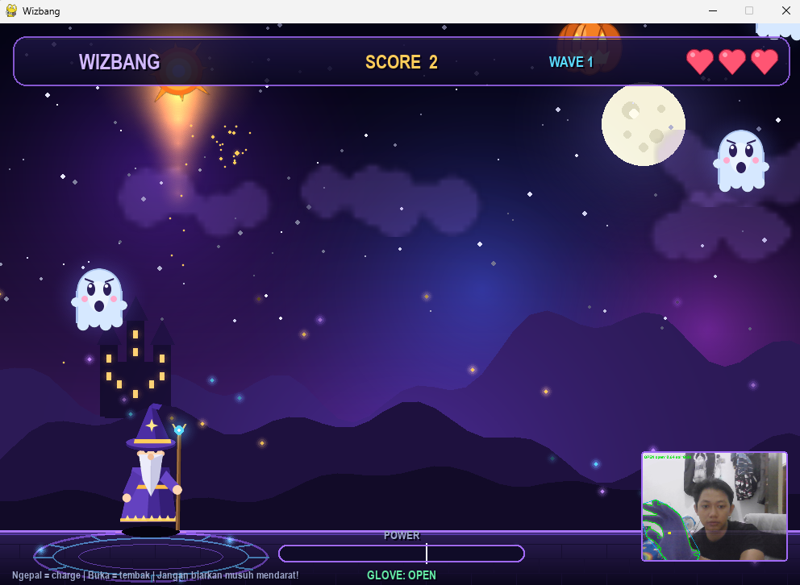
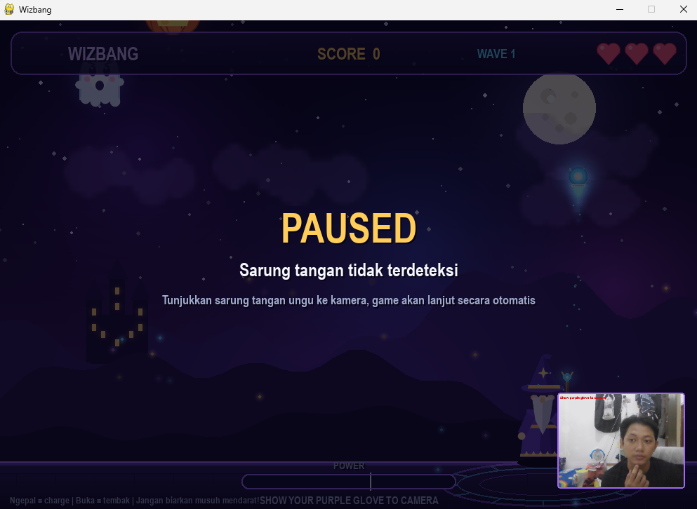
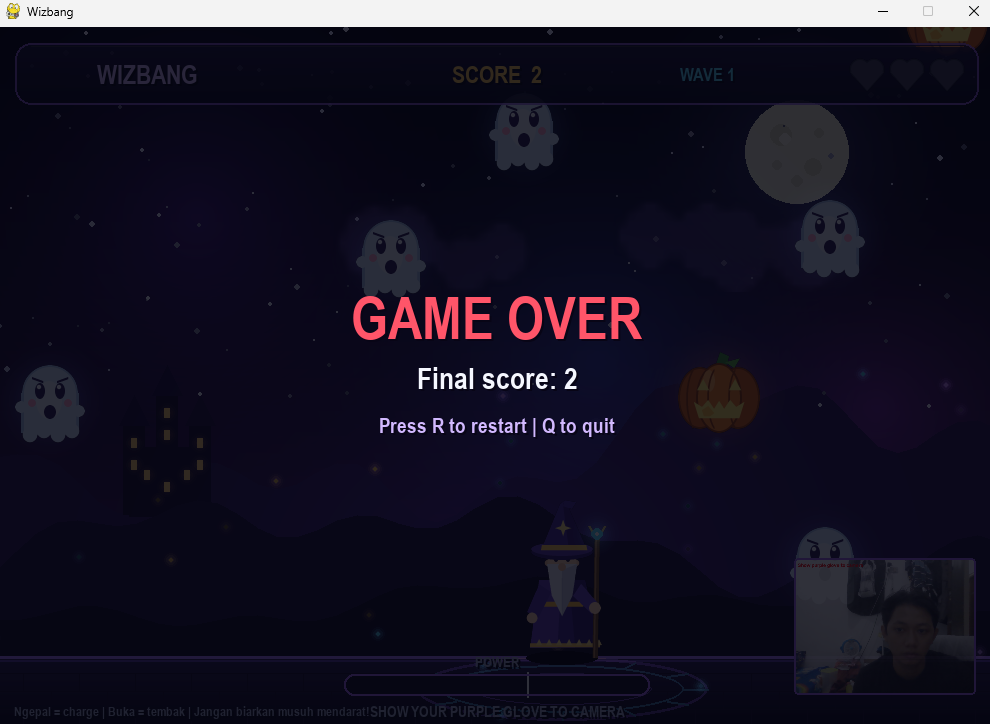

# Wizbang

Game sederhana yang dikontrol menggunakan sarung tangan ungu lewat webcam. Pemain jadi penyihir yang menembak musuh yang turun dari atas layar. Deteksi tangan memakai threshold warna HSV dan analisis kontur dengan OpenCV.

Dibuat untuk tugas mata kuliah PCV.

## Screenshot

Menembak:



Pause (sarung tangan tidak terdeteksi):



Game over:



## Dependencies

- Python 
- Webcam
- Sarung tangan berwarna ungu

Library yang dipakai:

- `opencv-python`
- `numpy`
- `pygame-ce`

Instal:

```
python -m pip install opencv-python numpy pygame-ce
```

Pakai `pygame-ce`, bukan `pygame`. Keduanya memakai nama modul yang sama, jadi jangan dipasang berbarengan.

## Menjalankan

```
python wizbang.py
```

Sebelum main, kalibrasi dulu gesture tangannya: buka tangan lebar lalu tekan `O`, kemudian ngepal lalu tekan `F`.

## Kontrol

Dengan sarung tangan:

- Geser tangan kiri/kanan: gerakkan penyihir
- Ngepal: isi tenaga spell
- Buka tangan: tembakkan spell
- Ngepal lebih dari 0,6 detik lalu buka: mega blast, menembus semua musuh
- Sarung tangan tidak terlihat kamera: game pause otomatis, lanjut sendiri saat terdeteksi lagi

Keyboard:

- Panah kiri/kanan: gerak
- Spasi (tahan lalu lepas): isi tenaga dan tembak
- `O`: kalibrasi tangan terbuka
- `F`: kalibrasi kepalan
- `R`: restart saat game over
- `Q` atau `Esc`: keluar

## Fitur

- Deteksi sarung tangan dengan HSV, lalu operasi morfologi untuk membersihkan noise
- Posisi tangan dari centroid kontur terbesar
- Deteksi ngepal dan buka tangan dari solidity kontur (luas kontur dibanding luas convex hull) dan luas kontur
- Kalibrasi gesture di dalam game
- Auto pause dan resume saat sarung tangan hilang dari kamera
- Tiga jenis musuh: hantu (biasa), kelelawar (cepat dan zig-zag), labu (lambat, butuh 2 tembakan)
- Musuh yang menyentuh tanah atau mengenai penyihir mengurangi 1 nyawa (total 3 nyawa)
- Kecepatan dan jumlah musuh naik seiring skor
- Semua gambar dibuat lewat kode, tidak ada file aset
- Jendela debug HSV Mask dan preview webcam untuk membantu tuning

## Cara kerja deteksi

1. Frame webcam di-flip lalu diubah ke HSV
2. `cv2.inRange` menghasilkan mask warna ungu
3. Mask dibersihkan dengan morphology open dan close
4. Kontur terbesar dianggap sebagai sarung tangan
5. Centroid kontur (`cv2.moments`) menentukan posisi penyihir
6. Solidity dan luas kontur menentukan tangan sedang terbuka atau mengepal. Tangan terbuka punya celah antar jari sehingga solidity-nya lebih rendah dibanding kepalan. Ada hysteresis supaya status tidak berganti-ganti terus.

## Masalah umum

- Webcam tidak terbuka: tutup aplikasi lain yang memakai kamera, atau ganti `CAMERA_INDEX` di bagian atas `wizbang.py` (coba `1`).
- Sarung tangan tidak terdeteksi: lihat jendela HSV Mask dan sesuaikan `LOWER_PURPLE` dan `UPPER_PURPLE` di `wizbang.py`. Pastikan cahaya cukup dan tidak ada benda ungu atau biru tua di belakang.
- Ngepal dan buka tidak terbaca benar: kalibrasi ulang dengan `O` dan `F`. Nilai `open=` di preview webcam mendekati 1 saat tangan terbuka dan mendekati 0 saat mengepal.
- Error saat instal atau import pygame: jalankan `pip uninstall pygame`, lalu `pip install pygame-ce`.

Hasil deteksi sangat dipengaruhi pencahayaan dan warna latar. Kalau pindah ruangan, sesuaikan atau kalibrasi ulang.
